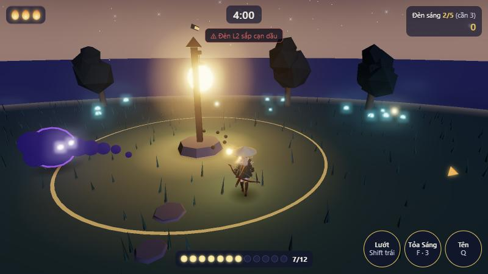

# Đảo Đèn Lồng — v1.0.0

> **Video demo:** _(sẽ đính kèm vào Release `v1.0.0`)_ · **Bản chạy được:** [Release v1.0.0](../../releases/tag/v1.0.0)



Game 3D góc nhìn thứ ba (Three.js). **Mây**, người giữ đèn nhỏ tuổi đội nón lá treo đèn, đi qua **3 Đêm** (Đảo Bến, Đảo Cau, Đảo Chuông): gom đom đóm, thắp và **châm dầu** cho các Đèn Lồng Lớn, né Bóng Mực hút dầu và Gió Lạc cướp đom đóm, giữ đảo sáng tới bình minh. Có chế độ **headless**, **benchmark** và **soak test** theo **Test Contract v1.3** để chấm tự động.

Lab: Day 12 AI SDLC (tài liệu lab ở [`docs/lab/`](docs/lab/README.md); ticket từng phase ở `docs/lab/ticket-0N.md`).

## Yêu cầu hệ thống
- macOS, Linux hoặc Windows; **Node.js ≥ 18** (đã thử Node 20 trên CI Ubuntu/macOS và Node 26 trên Windows 11).
- Trình duyệt có WebGL2 (Chrome, Edge, Firefox, Safari mới). GPU tích hợp là đủ (đo trên AMD Radeon 890M: ~238 fps trong cảnh bench).
- RAM 4 GB+. Khoảng 200 MB đĩa (thêm ~150 MB nếu cài Chromium cho bench).

## Cài và chơi (2 lệnh)

```bash
npm install       # cài three, vite, playwright
npm start         # build ra dist/ rồi mở game ở http://localhost:5173 (kèm bảng xếp hạng lưu trên đĩa)
```

### Mở game trên web từ bản phát hành (không cần `npm install`)

1. Tải `dao-den-long-v1.0.0-web.zip` ở [Release v1.0.0](../../releases/tag/v1.0.0) rồi giải nén.
2. Mở terminal trong thư mục vừa giải nén, chạy `node serve.mjs` (cần Node.js ≥ 18).
3. Trình duyệt tự mở `http://localhost:5173`. Nếu không tự mở, dán địa chỉ đó vào Chrome/Edge/Firefox/Safari. Đổi cổng: `node serve.mjs --port 8080`.
4. Bấm vào màn chơi để khoá chuột. Bảng xếp hạng lưu ở `data/leaderboard.json` cạnh `serve.mjs`.

Lưu ý:
- **Không mở `dist/index.html` bằng double-click:** trình duyệt chặn tải module và model qua `file://`.
- Thư mục `dist/` cũng chạy được trên bất kỳ host web tĩnh nào (GitHub Pages, Netlify, `npx serve dist`), vì đường dẫn trong bản build là tương đối. Khi đó bảng xếp hạng lưu trong trình duyệt (`localStorage`) thay vì file trên đĩa.

## Điều khiển (đổi được trong Cài đặt)

| Phím mặc định | Việc |
|---|---|
| W A S D | Đi (theo hướng camera) |
| Chuột | Xoay camera (bấm vào màn chơi để khoá chuột; Esc để nhả = tạm dừng) |
| Space | Nhảy |
| Shift trái | Lướt (14 m/s, 0.2 s, hồi 1.5 s), Mây lộn một vòng |
| E | Nạp ánh sáng / châm dầu cho đèn gần nhất (trong 2 m) |
| F | Tỏa Sáng: tốn 3 đom đóm, choáng + đẩy Bóng Mực trong 5 m, hồi 3 s |
| Q | Bắn tên *(kỹ năng sáng tạo)*: làm Bóng Mực đầu tiên trên đường bắn choáng 1 s, hồi 1 s |
| P / Esc | Tạm dừng (Tiếp tục / Chơi lại Đêm / Cài đặt / Về menu) |
| Lăn chuột | Zoom camera · `` ` `` hoặc F3: đồng hồ FPS |

**Kỹ năng sáng tạo** (bắn tên, chạy nhanh bẩm sinh sau 1.5 s chạy liên tục) là phần thêm của người học: chỉ có trong cửa sổ game và tắt được trong Cài đặt. Headless, bench và soak **không bao giờ** dùng chúng ([ADR-002](docs/adr/ADR-002-creative-mode-and-may-model.md)).

**Cài đặt** (được lưu): âm lượng, độ nhạy chuột, đổi phím (báo trùng, khôi phục mặc định), bảng màu dễ phân biệt, giảm chuyển động (tắt rung + chớp), chữ lớn ×1.25, bật/tắt kỹ năng sáng tạo.

## Luật chơi (Ticket-03)
- Đèn hao 1 dầu/giây; châm bằng đom đóm (1 đom đóm = 10 dầu). Hết dầu thì tắt; thắp lại chỉ cần 5 đom đóm.
- Đèn dưới 30 dầu mất vùng an toàn; Bóng Mực tới hút dầu (5/giây mỗi con).
- **Thắng một Đêm:** còn sống lúc bình minh với ít nhất 60% số đèn đang sáng (3/5, 4/6, 5/7). Thời lượng 240 / 270 / 300 s.
- Sức chứa đom đóm 10 + 2 mỗi lần thắp thành công (tối đa 20).
- Điểm: +5 mỗi đom đóm nạp/châm, +100 thắp lần đầu, +40 thắp lại, +5 Tỏa Sáng trúng bóng (+15 nếu nó đang hút); khi thắng: +50 + dầu còn lại mỗi đèn sáng, +50 mỗi Ngọn Lửa.
- Thua hoặc thắng Đêm 3 thì nhập tên để vào **Bảng xếp hạng** (top 10, có ở menu chính).

Chi tiết và lịch sử thay đổi luật: [CHANGELOG.md](CHANGELOG.md).

## Test, headless, bench, soak

```bash
npm test                                                     # 62 test: luật, contract v1.0–v1.3, headless, bench scene, soak, leaderboard
node headless.mjs --seed 1 --night 1 --ticks 600 --out out.jsonl [--scenario f.json] [--inputs f.json] [--snapshot-every 10]
npx playwright install chromium                              # một lần, cho bench
node scripts/bench.mjs --seed 42 --duration 30 --out bench.json
node --expose-gc soak.mjs --seed 7 --nights 10 --out soak.json
node serve.mjs --export-leaderboard out.json                 # {"entries": [...]} đúng thứ tự
```

- Khai báo cho máy chấm: [`game.contract.json`](game.contract.json) (`build_cmd`, `run_cmd`, `headless_cmd`, `bench_cmd`, `soak_cmd`, `tuning`).
- **Headless:** 60 tick/s, không cần GPU; file sai → exit 2; tất định từng byte. Một Đêm 21.600 tick chạy < 1 s.
- **Bench:** mở Chromium có cửa sổ (Playwright), viewport 1280×720, **vsync tắt** bằng `--disable-gpu-vsync --disable-frame-rate-limit`. Cảnh chuẩn: Đêm 1, 200 Bóng Mực `wander`, 100 đom đóm, L1–L3 sáng; camera bay vòng r = 30 m, Y = 15 m, 15 s/vòng; 3 s khởi động + 30 s đo. Không có Chrome thì thử Chrome/Edge cài sẵn (`DDL_BROWSER_CHANNEL=msedge`). `peak_mem_mb` = RSS cộng dồn của cây tiến trình trình duyệt. Kết quả của mình: [`bench.json`](bench.json).
- **Soak:** 10 Đêm trong 1 tiến trình, input ngẫu nhiên theo seed. Kết quả: [`soak.json`](soak.json).
- Bằng chứng từng phase: [Phase 1](docs/proof/phase-1.md) · [Phase 2](docs/proof/phase-2.md) · [Phase 3](docs/proof/phase-3.md) · [Phase 4](docs/proof/phase-4.md) · [hình ảnh/FPS](docs/proof/visual.md).
- CI (GitHub Actions, Ubuntu + macOS): test, build, headless 2 lần so byte.

## Tài liệu
[CHANGELOG](CHANGELOG.md) · [CREDITS](CREDITS.md) · [LICENSE](LICENSE) (MIT) · [ADR-001](docs/adr/ADR-001-lantern-fuel-and-dawn-win.md) · [ADR-002](docs/adr/ADR-002-creative-mode-and-may-model.md) · giả định `docs/notes/phase-N.md` · [nhật ký dùng AI](docs/notes/ai-log.md) · [retro](docs/notes/retro.md)

## Harness AI
[`AGENTS.md`](AGENTS.md) / [`CLAUDE.md`](CLAUDE.md) · Stop hook chặn kết thúc khi test đỏ ([`.claude/settings.json`](.claude/settings.json) → [`scripts/stop-gate.mjs`](scripts/stop-gate.mjs)) · skill [`verify`](.claude/skills/verify/SKILL.md) · MCP Ludo/Tripo ([`.mcp.json`](.mcp.json), key qua biến môi trường).
